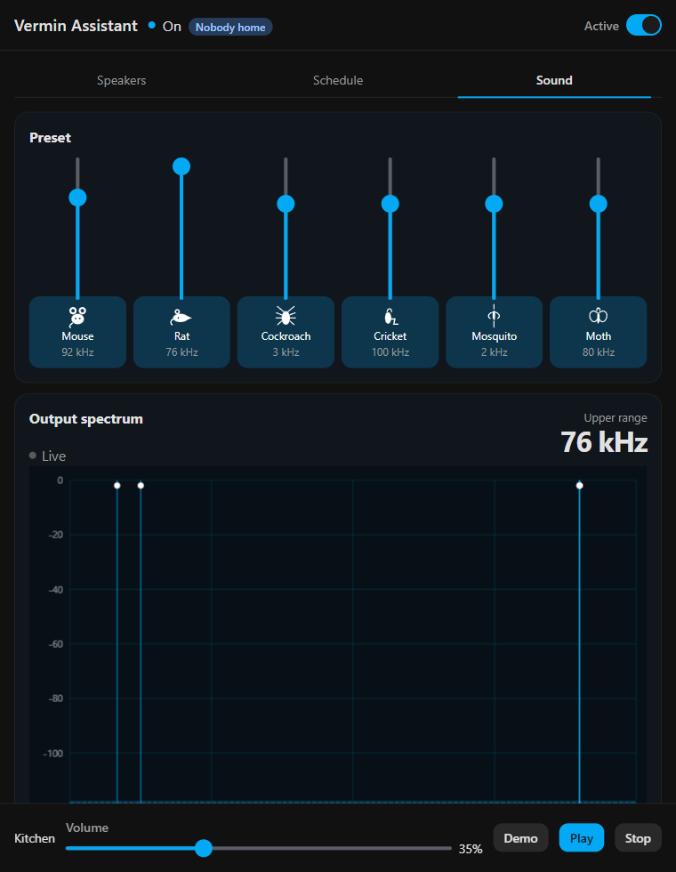

# Vermin Assistant

Home Assistant add-on. It plays an original high-frequency deterrent on the media players you select.



## Install

In Home Assistant, open **Settings → Add-ons → Add-on store → ⋮ → Repositories** and add:

```text
https://github.com/zodyking/Vermin-Assistant
```

Install **Vermin Assistant**, start it, and open the panel. **Show in sidebar** pins it.

For a local install, copy the `vermin_assistant` folder to `/addons`. The folder name must stay `vermin_assistant`.

## Panel

- **Sound.** Mouse, rat, cockroach, cricket, mosquito, and moth. Each level drives that animal’s upper hearing range. **Demo** plays here. **Play** and **Stop** use the selected speakers.
- **Schedule.** Hours, when nobody is home, or both. The hour repeats until the schedule ends.
- **Speakers.** Media players that can play audio.

The tone is generated by the add-on. The YouTube recording “Mouse & Rat Ultrasonic Deterrent” is not included.

## Develop

React 19.3.1 and Astryx 0.7.13.

```powershell
cd vermin_assistant
python -m venv .venv
.\.venv\Scripts\pip install -r app/requirements.txt
$env:VERMIN_ASSISTANT_DEV = "1"
$env:VERMIN_ASSISTANT_DATA = "data"
$env:VERMIN_ASSISTANT_MEDIA = "data/media"
$env:VERMIN_ASSISTANT_STATIC = "frontend/dist"
python -m app.server
```

From `vermin_assistant/frontend`:

```powershell
npm install
npm run dev
```
